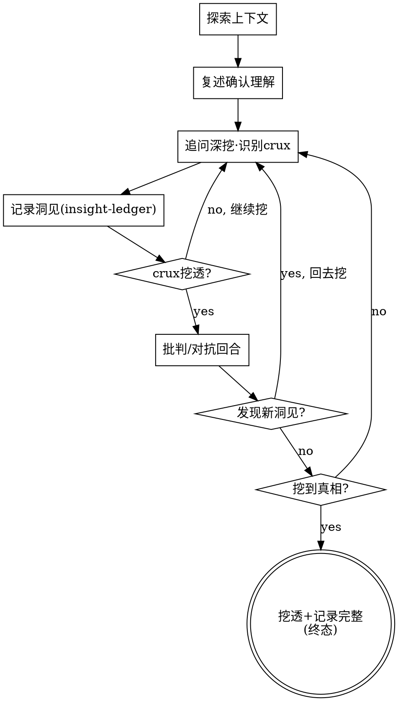

# 深度洞见挖掘 Skill

把一个想法 / 痛点 / 议题，通过**批判性协作对话**往下挖，直到挖出**最真实的真相**为止。

> **边界**：本 skill **只负责「洞见发现」**——把议题挖到真相、并把洞见记录下来。**挖透之后如何收敛（需求分析 / 设计 / 决策 / 实现等），由各自下游流程承接，不属本 skill。**

## 适用角色

尤其适合**设计类角色：PM、SA、TA** 等——他们的价值不在「接需求照做」，而在**主动挖掘出隐藏问题、看穿表象、直抵本质**。但作为通用 skill，任何需要挖到问题本质的场景都可用。

## 为什么需要它（它防的失败）

常见失败：① **过早收敛**：还没想透就跳到方案 / 结论；② **停在表层**：把对方说的第一层诉求当成真需求，不追问背后；③ **用形式顶替实质**：套模板写文档，crux 从没被点破；④ **洞见在收敛时蒸发**：讨论里挖到的关键点，落文档 / 下结论时丢了。结果是**别人被迫当你的 QA**，逐轮把本质捡回来。

本 skill 就是治这些病：**先挖透、再收敛；边挖边记录；完成前自我批判**。

## HARD-GATE（反过早收敛）

在**① 识别并挖透 crux（地基问题）**、且**② 把关键洞见记录下来（含推理）**之前，**禁止**：
- 跳到解决方案 / 技术实现 / 数据结构 / 接口；
- 开始写文档、下最终结论；
- 宣布「我懂了，可以开工」。

**这条对任何议题都适用，无论它看起来多简单。** 越「简单」的议题，越是未经审视的假设埋雷的地方。

## Checklist（建成 task，按序完成）

1. **探索上下文** — 读相关文件 / 文档 / 历史，别在空气里挖。
2. **复述确认理解** — 用自己的话复述对方意思，先把「我以为的」和「他说的」对齐（最容易出错的地方）。
3. **追问深挖，识别 crux** — 往下挖到「后面大量结论都从这里推导」的地基问题；边挖边记录。
4. **批判 / 对抗回合** — 主动找漏洞：目标达成了吗？漏了什么？这个假设成立吗？概念有没有混淆？
5. **判断是否挖到真相** — 用「退出判据」检验（见下）；没到就回第 3 步。
6. **记录完整** — 关键洞见（含推理过程、反例、纠错）已登账（推荐用 `insight-ledger`）。
7. **收尾** — 「挖透 + 记录完整」即为本 skill 的终态；**后续收敛交下游流程，不属本 skill**。

## Process Flow

## 四个内核

### 内核一 · 深挖到 crux（地基问题）

不要停在对方说的第一层。往下挖，直到找到那个「**后面大量结论都从它推导**」的地基问题——它往往没被明说。挖到后**摊开做透**（成表 / 成段的分析），而非一句带过。

**深挖技法：**
- **复述确认**：用自己的话复述对方意思，让误解当场暴露（常有「你以为的 A」其实是「他说的 B」）。
- **追问 why / 根因**：对每个诉求连问「为什么」，直到根因——表层症状往往不是病根。
- **区分表象与本质**：对方给的常是解决方案，不是真需求——还原到他真正想达成的结果。
- **类比 / 映射**：用一个熟悉结构去照另一个，系统性逐项映射，缺口与遗漏自现。
- **反例与边界**：拿极端 / 边界 / 反例试结论——一个站不住的反例能揭穿一个粗率的一般化。

### 内核二 · 批判 / 对抗回合（对他人和自己都批判）

每要收敛一步，先当自己的反方：
- **目标回验**：这真能达成最初的目标吗？
- **漏了什么**：有没有一整个维度没被讨论到——尤其那些不在现有模板 / 框架里、极易被结构性忽略的。
- **假设审查**：这个结论依赖哪些没说出口的假设？它们成立吗？
- **概念澄清**：有没有把两个不同的东西混为一谈（同名不同物、层次混淆）。
- **同构检查**：两个看似无关的问题是不是同一个病灶——若是，一个修法可解两处。

> 批判也指向**对方的表述**：提出方也可能把话说岔、把概念混淆——要点破并请其澄清，而不是照单全收。

### 内核三 · 边挖边记录（配套 insight-ledger）

**每得一个洞见，当场记录（记推理过程，不只记结论）**，不靠事后记忆——推荐用 `insight-ledger`。记录是这段挖掘的产出物之一，也是防「收敛时蒸发」的机制。

### 内核四 · 反过早收敛（见 HARD-GATE）

没挖到 crux、没记录，**绝不**跳方案 / 下结论 / 写文档。治「没挖透就急着收敛、把洞见丢在半路」的病。

## 什么时候算「挖到真相了」（退出判据）

同时满足才可收敛：
- **crux 已识别并挖透**：地基问题被点破、摊开成分析，不再有「说不清为什么」的地方；
- **没有悬空的 why**：每个关键结论都能追到根因；
- **假设已浮出并确认**：依赖的隐含假设都被显式化、经确认或标为待确认；
- **矛盾 / 概念混淆已消解**；
- **目标回验通过**：这套结论确实承接最初目标；
- **已记录**：含推理过程、反例、纠错。

> 反问自检：把这段挖掘讲给一个没参与的人，他能否复现「真正的问题是什么、为什么」？不能，就还没挖到。

## 关键原则

- **先挖透，再收敛** — 深度优先于速度。
- **允许深、允许长、不过早收敛** — 与「快速收敛」类 skill 相反：该铺开的推理就铺开。
- **表象不是真相** — 第一层诉求通常是解决方案，不是真需求。
- **对他人和自己都批判** — 双向挑战假设。
- **实事求是** — 不用「完成的口吻」掩盖没挖透的部分；没挖透就说没挖透。
- **边挖边记录** — 洞见即时固化，记过程。

## 反模式（出现即返工）

- ❌ 停在对方说的第一层，不追问背后。
- ❌ 议题没做透就跳到方案 / 下结论。
- ❌ 地基型 crux 没被点破，直接套模板写文档。
- ❌ 只问问题、不做深度分析（问答 ≠ 深挖）。
- ❌ 照单全收对方表述，不点破其中的概念混淆 / 口误。
- ❌ 挖到的洞见不记录，等收敛时才发现丢了。
- ❌ 用「完成的口吻」掩盖没想透的部分，让别人来当 QA。

## 配套 skill

- `insight-ledger`：本 skill 的**记录 / 追溯**产物——边挖边登账、记思考过程。

> 本 skill 到「挖透 + 记录完整」为止。**下游的需求分析 / 设计 / 决策 / 实现等各自独立，不由本 skill 负责，也不在此描述。**

## 完成后自检清单

- [ ] crux 已识别并摊开做透，没有「说不清为什么」的地方？
- [ ] 每个关键结论都追到了根因，无悬空 why？
- [ ] 隐含假设已浮出，经确认或标为待确认？
- [ ] 概念混淆 / 矛盾已消解？
- [ ] 目标回验通过？
- [ ] 关键洞见（含推理、反例、纠错）已记录？
- [ ] 没有把没挖透的部分用完成口吻带过？
