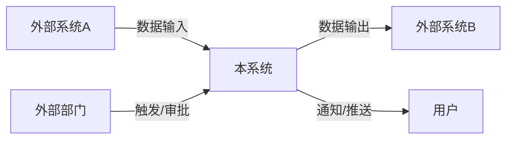
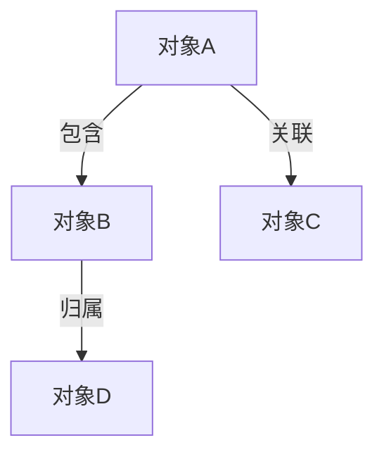
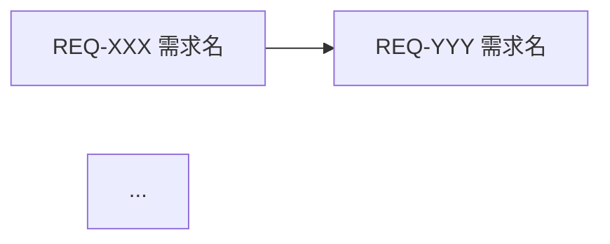

# 用户需求分析 Skill

## 核心原则

**严格禁止**在完成用户需求分析之前提出任何技术实现、数据结构、接口设计或软件功能细节。

用户需求分析 ≠ 软件需求设计。必须先完成前者，再进入后者。

```
痛点/想法
    ↓
【阶段一】背景与痛点澄清   ← 本 skill 负责
【阶段二】用户角色与旅程   ← 本 skill 负责
【阶段三】业务流程梳理     ← 本 skill 负责
【阶段四】边界与约束       ← 本 skill 负责
    ↓
【产出】用户需求文档       ← 本 skill 负责
    ↓
【软件需求设计】           ← 用户确认后才进入
    ↓
技术实现
```

### insight-first：先承接洞见，模板只作容器

若本议题在讨论阶段走过 `insight-discovery` 并产出了**洞见账本**（`insight-ledger` 产物，落 `docs/insights/`），写报告时**必须以账本为事实源、insight-first 地写**：

1. 先把账本里**每一条关键洞见**映射到本报告的落点；
2. 再用下面的模板当**容器**保完整；
3. **某条洞见在模板里没有槽位，就加章节——绝不为迁就模板而把它丢掉。**

即使没有正式账本，动笔前也要先列一份「本次讨论的关键洞见清单」，照它写。

> 反模式：让通用模板当**骨架**、往里填，导致模板里没槽位的洞见（领域独有的 crux、关键区别、单点行为等）被结构性遗漏——**用形式顶替实质**。模板服务内容，不是反过来。

### 立意层按「新产品 / 迭代」分档

角色、用户旅程、用户场景、业务架构（产出 §二~§七）是**需求之源**——决定需求"全不全"，也是评审判断"对不对"的坐标系。

- **新产品**：无既有共识，**必须完整立起来**——不立坐标系，则下游需求全部无根、覆盖度无从判断。
- **迭代版本**：**引用**既有角色/场景 + 只写**增量**，不重复铺陈。

⚠️ 警惕两种失真：① 编造情绪 😟、为画图而画图、堆教科书式虚构 persona——真实项目的"角色"往往是**权限角色 + 真实使用情境**，写 load-bearing 的，别填表；② 迭代版硬套完整模板 = 仪式化。

### 本期范围二值化（防"静默蒸发"）

每条需求必须打**本期范围**硬标记：✅ 本期IN(Must) / 🔸 本期IN(Should) / ⛔ 本期OUT（→列入下一版）。**"次要/辅助/以后再说"等软措辞一律不得入文档**——它们正是需求被下游静默丢弃、拖到验收才发现缺口的入口。范围与优先级**正交**：不做但重要 = OUT + P0。

---

## 访谈流程（结构化分阶段）

**访谈前先读洞见账本。** 本议题在 `docs/insights/` 下有洞见账本（`insight-ledger` 产物）的，开始访谈前先读完：

- 账本「决策追溯表」里已定的结论**不再提问**：在相应阶段开头列为「已承接」，注明账本条目，请用户一次性确认或纠正；
- 账本「欠账清单」里的未决项，优先作为问题提出。

每个阶段一次性提出 3-5 个问题，等待用户回答后再进入下一阶段。**不要逐问逐答**，也**不要跳过阶段**。

**每个问题附一个推荐答案和一句理由**，用户可以直接采纳或改写：

- 能从洞见账本推出的，注明出自哪条洞见；账本里没有依据的，标明「PM 的推荐」；
- 推荐答案**不得与账本已定的结论冲突**；觉得账本结论本身有问题，就把它作为问题提出，不悄悄换一个答案；
- 没把握的问题不给推荐答案，明说没把握。推荐只是建议，需求内容仍由 PM 和产品负责人决定。

---

### 阶段一：背景与痛点澄清

目标：理解真实问题，防止过早收敛到解决方案。

提问方向：
- 现在是怎么做的？（现状）
- 哪个环节最让你头疼？（核心痛点）
- 这个问题发生多频繁？影响多少人？（严重程度）
- 有没有已经在用的工具或临时方案？为什么不够用？（现有方案的不足）
- 如果这个问题解决了，最理想的状态是什么？（目标愿景）

⚠️ 注意：用户描述的解决方案不一定是真实需求，要追问"为什么"，挖掘背后的真实目标。

---

### 阶段二：用户角色与旅程

目标：明确系统服务谁，识别每个角色的完整使用旅程和情绪低谷。

提问方向：
- 这个系统会有哪些不同类型的使用者？（角色枚举）
- 每种角色的核心目标是什么？他们最关心什么结果？
- 使用频率和使用场景是什么？（日常用/偶尔用，PC/移动/后台）
- 有没有外部系统或第三方需要对接？
- 谁是主要决策者？谁是数据录入者？谁是结果查看者？
- 针对每个主要角色：从第一次接触系统到完成目标，中间经历哪些阶段？哪个阶段最容易出问题或最让人沮丧？
- 这个系统之外，还有哪些系统或部门会和它交互？数据从哪里来、流向哪里？（业务上下文）
- 系统里最核心的"名词"是什么？比如订单、用户、合同、设备——它们之间是什么关系？（业务对象）
- 这个系统要支撑哪些业务能力？哪些能力是核心自建，哪些可以复用已有系统或外采？（业务能力）

⚠️ 旅程复杂度判断：角色超过 2 个或使用阶段超过 4 步，使用完整旅程地图模板；否则使用简化版。

---

### 阶段三：业务流程梳理

目标：理清信息如何流转，识别关键节点与异常路径。

提问方向：
- 完成一件完整的事，需要经历哪些步骤？（主流程）
- 每个步骤由谁来做？需要什么信息输入？产出什么结果？
- 哪些步骤需要审批、通知或协作？
- 最常见的异常情况是什么？出错了怎么处理？
- 有没有需要定时触发的流程？还是全部由人工触发？

---

### 阶段四：边界与约束

目标：确定系统范围，识别外部依赖，避免范围蔓延。

提问方向：
- 哪些事情一定要在这个系统里做？哪些不需要？
- 有没有合规、监管或安全方面的硬性要求？（等保/密评/行业规范）
- 有没有依赖外部系统改造完成才能推进的功能？（外部依赖）
- 数据量级大概是多少？对性能有没有具体指标要求？
- 上线时间有没有硬性要求？是一次全上还是分期迭代？
- 需要兼容哪些已有系统或旧版本？

---

## 产出规范

完成四个阶段访谈后，生成两份产出：

### 产出一：对话内 Markdown 摘要（直接呈现）

```
# [系统名称] 用户需求文档

| 项目 | 内容 |
|------|------|
| 版本号 | v1.0 |
| 编写日期 | YYYY-MM-DD |
| 需求总数 | N 条 |

---

## 一、背景与目标

### 项目背景
（说明业务背景、触发原因、当前面临的能力缺口）

### 业务目标

| 目标维度 | 指标 | 关联需求 |
|---------|------|---------|

### 名词解释

| 名词 | 解释 |
|------|------|

---

## 二、用户角色

| 角色 | 使用场景 |
|------|---------|

---

## 三、用户旅程

> 每个主要角色单独一张旅程图。根据系统复杂度选择完整版或简化版。

### 3.1 完整旅程地图（系统复杂、角色 >2 或阶段 >4 步时使用）

**[角色名称] 旅程地图**

| | 阶段一：[名称] | 阶段二：[名称] | 阶段三：[名称] | 阶段四：[名称] |
|---|---|---|---|---|
| **用户行为** | ... | ... | ... | ... |
| **触点** | ... | ... | ... | ... |
| **情绪** | 😐 平静 | 😊 期待 | 😟 困惑 | 😃 满意 |
| **痛点** | ... | ... | ... | ... |
| **机会点** | ... | ... | ... | ... |

> 情绪参考：😃 满意 / 😊 期待 / 😐 平静 / 😟 困惑 / 😤 沮丧 / 😠 愤怒

---

### 3.2 简化旅程（系统简单、角色 ≤2 或阶段 ≤4 步时使用）

**[角色名称] 旅程**

| 阶段 | 用户行为 | 痛点 | 机会点 |
|------|---------|------|-------|
| [阶段一] | ... | ... | ... |
| [阶段二] | ... | ... | ... |

---

> ⚠️ 旅程图的核心价值：识别情绪低谷阶段 → 这些阶段对应的功能优先级通常是 P0。

---

## 四、业务架构

### 4.1 业务上下文图
（描述本系统在整个业务版图中的位置，以及与外部系统/部门的交互关系）



| 外部系统/部门 | 交互方向 | 交互内容 | 依赖程度 |
|-------------|---------|---------|---------|
| ... | 输入/输出/双向 | ... | 强依赖/弱依赖/可选 |

---

### 4.2 业务对象模型
（系统核心"名词"及其关系，概念级，不涉及字段细节）



| 业务对象 | 说明 | 与其他对象的关系 |
|---------|------|---------------|
| ... | ... | ... |

> ⚠️ 此处只定义概念和关系，不定义字段——字段属于软件需求设计阶段。

---

### 4.3 业务能力地图
（系统支撑哪些业务能力，按层次组织，标注自建/复用/外采）

```
[系统名称] 业务能力
├── 核心能力层
│   ├── 能力一（自建）
│   └── 能力二（自建）
├── 支撑能力层
│   ├── 能力三（复用已有系统）
│   └── 能力四（外采）
└── 基础能力层
    └── 能力五（平台提供）
```

| 业务能力 | 层次 | 构建方式 | 支撑的业务目标 |
|---------|------|---------|-------------|
| ... | 核心/支撑/基础 | 自建/复用/外采 | ... |

---

## 五、用户场景

### 场景 N：[场景名称]

| 项目 | 内容 |
|------|------|
| 业务背景 | 为什么要做这件事 |
| 技术现状 | 现在卡在哪里，现有方案的不足 |
| 用户诉求 | 用户真正想要什么结果 |
| 适用对象 | 哪些角色涉及（配置者/使用者/验证者） |
| 前提条件 | 做这件事的前置依赖（外部系统/基础设施） |
| 操作流程 | 主流程步骤；如有多方案用"方案一/方案二"区分 |
| 关键需求点 | 核心约束、技术要点、不可妥协的边界条件 |

（每个核心场景单独一节）

---

## 五-附、角色 × 场景覆盖度矩阵（覆盖度基准）

行 = 角色（§二），列 = 场景（§五）；格子填覆盖该〈角色 × 场景〉的需求编号（§八 US）；空格 = 盲区候选，**必须显式判为"不适用"或补需求**。

| 角色＼场景 | 场景1 | 场景2 | … |
|---|---|---|---|
| 角色A | US-… | — | … |
| 角色B | US-… | US-… | … |

**矩阵一物两用**：
- **发散时 = 脚手架**：先按格子铺需求，保证不漏任何〈角色 × 场景〉（新产品尤其防漏）。
- **收敛后 = 校验器**：需求按模块编号写完（§八）后，回矩阵逐格核对——每格有 US 或显式"不适用"，空着即欠账（见「可追溯自检」）。

> ⚠️ 需求与角色/场景是**多对多**，故需求编号主轴用**功能模块**（§八），**不用角色/场景当编号轴**——否则一条跨角色需求会被割裂/重复挂，制造新的蒸发。矩阵只做覆盖校验。

---

## 六、业务流程

（每条核心流程用 Mermaid sequenceDiagram 表示，标注主流程和异常分支）

```mermaid
sequenceDiagram
    participant A as 角色A
    participant B as 角色B
    ...
```

---

## 七、系统功能模块全貌

（模块树结构）

```
系统名称
├── 模块一
│   ├── 功能 1.1
│   └── 功能 1.2
├── 模块二
...
```

---

## 八、需求清单（双视图 · 同 ID 绑定）

需求条目分三类：**R** 业务规则（达标/计算口径，无用户操作动作）／**US** 用户故事（用户可感知的最小功能）／**NFR** 非功能约束（见 §十）。
本清单同一批条目投影为两个视图；**评审视图与规格视图的 US ID 集合必须完全相等**（见「可追溯自检」），缺一即需求蒸发。

> 编号主轴 = **功能模块**（如 US-T01=阈值模块）。角色/场景只做覆盖校验（§五-附），不做编号轴。

### 8.1 评审视图（疏 · 供人评审判断"要什么 / 为什么 / 优先级 / 全不全"，不含 AC）

**业务规则 R**

| ID | 规则（一句话） | 为什么这么定 |
|---|---|---|

**用户故事 US**

| ID | 需求（一句话，可写「作为X要Y以便Z」的压缩） | 本期范围 | 优先级 | 为什么要 |
|---|---|---|---|---|

> 本期范围：✅IN(Must) / 🔸IN(Should) / ⛔OUT（→列入下一版）。与优先级正交。

### 8.2 规格视图（密 · 供 SE/QA 执行，评审"可测性"时按 ID 下钻）

按 ID 展开每条 US：

**US-XXX｜[标题]**
- AC1｜可测判定条件（数值 / 边界 / 降级都写死，不留模糊区间）
- AC2｜…
- 追溯：`<下游 task / spec 章节；未排期标 deferred>` ｜ 交付状态：`未开始 / 开发中 / ✅已交付 / ⏳待核 / ⛔本期不实现`

业务规则 R 用判定点表：

| ID | 可验证判定点 | 追溯 | 交付状态 |
|---|---|---|---|

> `追溯` 与 `交付状态` 由下游推进时回填——需求文档因此同时是**交付看板**，缺口（OUT / 待核）始终可见。

---

## 九、需求依赖关系



| 依赖关系 | 说明 |
|---------|------|

---

## 十、非功能需求（NFR · 条目化，同样可验收、可追溯）

NFR 与 US 同规格——**带 ID、本期范围、可验证判定点、追溯、交付状态**，不写成一句口号。隐私/安全/性能红线尤其要落成可实测条目（如"抓 X 接口响应无个人字段"），别只活在下游设计的"红线说明"里。

| ID | 约束（一句话） | 类别 | 本期范围 | 可验证判定点 | 追溯 | 交付状态 |
|---|---|---|---|---|---|---|
| NFR-01 | … | 性能/安全/隐私/兼容/升级 | ✅IN | （可实测的具体判定） | … | … |

> 按类别（性能 / 安全 / 隐私 / 兼容 / 升级）归组呈现即可；每条必须可实测。

---

## 十一、系统边界

- **包含**：...
- **不包含**：...
- **待定**：...

---

## 十二、关联文档

| 文档 | 说明 |
|------|------|
```

### 产出二：落库的需求文档

完成 Markdown 摘要、用户确认后，写入仓库：

```text
docs/prds/{版本号}/用户需求文档-{标识}.md
```

标识 = 版本号（版本级）或工作项号（REQ / ISSUE 等单点需求）。**落位与命名的完整口径以 `manage-docs` skill 为准，本节不重复**；拿不准版本归属由 SA 判定。

---

## 阶段切换规则

- 每个阶段提问后，**等待用户完整回答**，不要催促
- 用户回答不完整时，可追问 1-2 个关键点，但不要超过 2 轮
- 用户明确说"跳过"或"不重要"时，记录为"待定"并继续
- 四个阶段全部完成后，给出一句总结确认："以上信息是否完整？有需要补充或修正的吗？"，再生成产出

---

## 常见陷阱与应对

| 陷阱 | 表现 | 应对方式 |
|------|------|---------|
| 用户直接给解决方案 | "我要做一个审批功能" | 追问：为什么需要审批？现在是怎么做的？ |
| 需求范围不断扩大 | 每回答一个问题加一个新想法 | 记录到"P2/待定"，聚焦当前核心 |
| 用户跳过流程直接问实现 | "这个功能怎么做？" | 提示：我们先完成需求分析，确认系统全貌后再讨论实现 |
| 多个角色需求混淆 | 描述时角色不分 | 明确提问：这是针对哪个角色的？ |
| 忽略外部依赖 | 只描述自身系统功能 | 追问：有没有依赖第三方系统或平台改造才能推进的部分？ |
| 合规要求后置 | 功能设计完了才想到合规 | 阶段四主动询问：有没有等保/密评/行业合规的硬性要求？ |
| 洞见落文档时丢失 | 讨论挖到的关键点，报告里找不到 | insight-first 承接 + 产出前逐条对账本自检 |
| 用模板顶替实质 | 套模板写得"齐全"，但 crux 从没被点破 | 模板作容器不作骨架，洞见没槽位就加章节 |

---

## 可追溯自检（产出前必做，别让用户当你的 QA）

报告初稿完成、宣布「完成」之前，**逐条走洞见账本（或关键洞见清单）自检**——每条洞见落到哪、落成什么：

- **✅ 已定** → 是否落成 **load-bearing** 内容（带验收标准的真需求 / 明确章节），而非一句带过？
- **⏳ 待确认** → 是否在报告里**显式标注**待确认，而非当已定糊弄过去？
- **🔭 远期** → 是否归入路线 / 蓝图，而非误塞进本版范围？

核不过的即为**欠账**，当场补齐或显式列出；随后回写账本的「落点 / 状态」。

**再过两道结构自检（防蒸发，缺一不可）**：
- **ID 一致性**：§八评审视图（8.1）与规格视图（8.2）的 US ID 集合**完全相等**？一边有、另一边无 = 蒸发，补齐。
- **覆盖度无盲区**：§五-附 角色×场景矩阵**每一格**都有 US 覆盖，或显式写明"不适用"？空格 = 该想没想到的需求盲区——补需求或标不适用，不留白。

最后再问一遍**最初目标**：这套需求真能承接它吗？

> 这一步是你给自己做 QA。做完它，用户才不必逐轮替你把丢掉的洞见捡回来。

---

## 完成后

0. **先过「可追溯自检」**（见上节），确认无欠账、无被丢掉的洞见，再宣布完成
1. 确认产物文件（用户需求文档 .md）已按 `manage-docs` skill 落位

---

## 参考文件

- `references/interview-templates.md`：不同场景的访谈问题模板（新产品/新模块/痛点驱动）
- `references/output-examples.md`：完整产出示例
