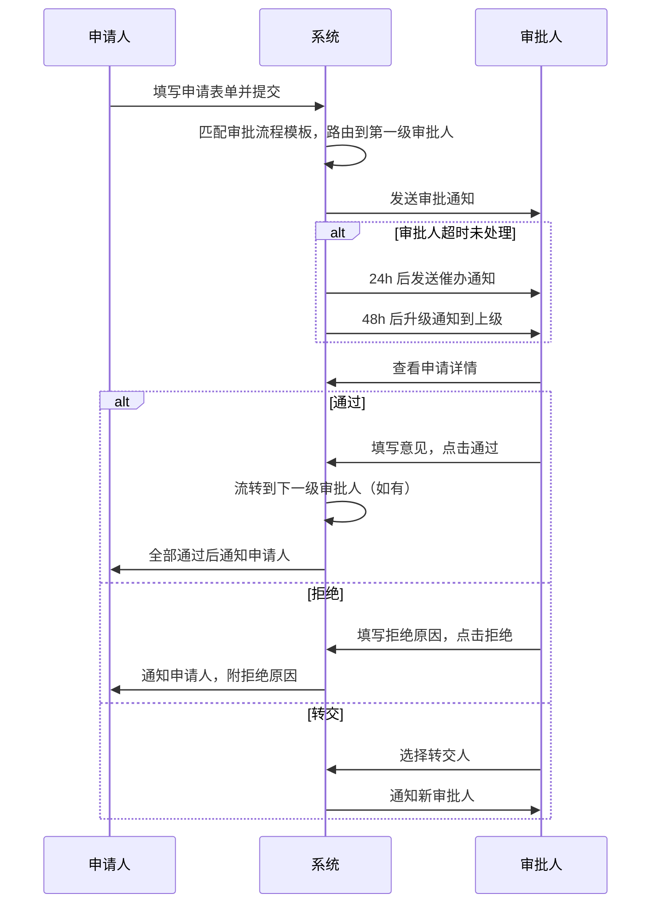
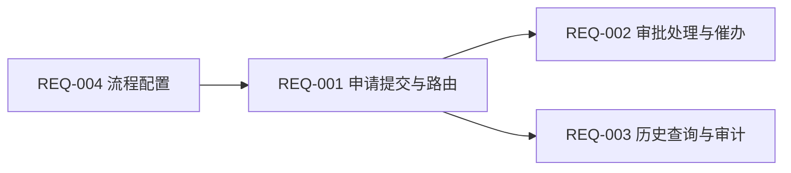

# 产出示例

## 示例：内部审批流程系统

---

# 内部审批流程系统 用户需求文档

| 项目 | 内容 |
|------|------|
| 版本号 | v1.0 |
| 编写日期 | 2026-06-17 |
| 需求总数 | 4 条 |

---

## 一、背景与目标

### 项目背景

各部门审批靠微信群传递，存在三个明显缺口：历史记录无法追溯、审批人漏批/误批、出问题后责任不清。随着公司规模扩大和合规要求趋严，需要将审批流程线上化、可追溯化。

### 业务目标

| 目标维度 | 指标 | 关联需求 |
|---------|------|---------|
| 审批线上化 | 100% 审批通过系统流转，消除微信群审批 | REQ-001/002 |
| 可追溯 | 所有审批记录保留 3 年，支持按人/时间/类型查询 | REQ-003 |
| 及时通知 | 审批人收到通知后 24h 内处理率 ≥ 90% | REQ-002 |
| 合规 | 满足公司内控审计要求 | REQ-003 |

### 名词解释

| 名词 | 解释 |
|------|------|
| 审批流 | 一条申请从提交到最终通过/拒绝的完整节点链路 |
| 代理人 | 审批人临时授权的替代处理人 |
| 催办 | 系统自动向超时未处理的审批人发送提醒 |

---

## 二、用户角色

| 角色 | 使用场景 |
|------|---------|
| 申请人 | 发起各类审批申请，跟踪审批进度 |
| 审批人 | 接收通知，查看申请详情，执行通过/拒绝/转交 |
| 管理员 | 配置审批流程模板、管理用户权限、查看统计报表 |
| 观察者 | 只读查看与自己相关的审批结果，不参与审批动作 |

---

## 三、用户场景

### 场景 1：发起审批申请

| 项目 | 内容 |
|------|------|
| 业务背景 | 员工需要发起费用报销、采购申请、请假等各类审批 |
| 技术现状 | 现在通过微信群 @相关人，无固定格式，信息不完整，审批人经常看漏 |
| 用户诉求 | 统一入口提交申请，填完即走，系统自动推给对应审批人 |
| 适用对象 | 申请人（提交）、审批人（接收通知） |
| 前提条件 | 管理员已配置对应审批类型的流程模板 |
| 操作流程 | 申请人选择审批类型 → 填写表单 → 提交 → 系统自动路由到第一级审批人并发送通知 |
| 关键需求点 | 表单字段可按审批类型配置；提交后不可修改，只能撤回；撤回仅限第一级审批前 |

### 场景 2：审批人处理申请

| 项目 | 内容 |
|------|------|
| 业务背景 | 审批人每天处理来自不同申请人的多条申请，需要快速判断并操作 |
| 技术现状 | 微信消息淹没在群聊中，经常漏看；无法在手机上快速操作 |
| 用户诉求 | 统一待办列表，移动端可直接处理，超时有催办提醒 |
| 适用对象 | 审批人（处理）、申请人（收到结果通知） |
| 前提条件 | 申请人已提交申请，系统已路由到该审批人 |
| 操作流程 | 审批人收到通知 → 查看申请详情 → 填写审批意见 → 通过/拒绝/转交；通过则流转下一级，拒绝则退回申请人 |
| 关键需求点 | 支持移动端操作；超过 24h 未处理自动催办；超过 48h 可升级到上级；支持设置代理人 |

---

## 四、业务流程



---

## 五、系统功能模块全貌

```
审批流系统
├── 申请中心
│   ├── 新建申请（按类型选模板）
│   ├── 我的申请（进度跟踪）
│   └── 草稿箱
├── 审批中心
│   ├── 待我审批
│   ├── 我已审批
│   └── 抄送我的
├── 流程配置（管理员）
│   ├── 审批类型管理
│   ├── 审批节点配置
│   └── 表单字段配置
├── 通知中心
│   ├── 站内通知
│   ├── 催办规则配置
│   └── 外部通知（邮件/企微）
└── 数据报表
    ├── 审批进度总览
    ├── 超时预警
    └── 历史数据导出
```

---

## 六、需求清单

### 模块一：申请与审批核心流程

#### REQ-001 申请提交与流程路由

| 项目 | 内容 |
|------|------|
| 优先级 | P0 |
| 需求来源 | 产品规划 |
| 技术复杂度 | 中 |
| 预期效果 | 申请人通过统一入口提交申请，系统自动路由到对应审批人 |

**功能概述**

申请人选择审批类型后填写对应表单，提交后系统根据预设流程模板自动路由到第一级审批人并触发通知。

**功能范围**

| 序号 | 功能项 | 说明 |
|------|--------|------|
| 1 | 审批类型选择 | 申请人从已配置的审批类型中选择 |
| 2 | 动态表单 | 根据审批类型渲染对应字段 |
| 3 | 提交校验 | 必填字段校验，不通过不允许提交 |
| 4 | 自动路由 | 提交后按流程模板路由到第一级审批人 |
| 5 | 撤回 | 仅在第一级审批人处理前可撤回 |

**验收标准**

1. 申请人可正常选择审批类型并填写提交
2. 提交后系统正确路由到配置的第一级审批人
3. 审批人收到通知（站内+企微）
4. 第一级审批前可撤回，撤回后流程终止
5. 第一级审批后不可撤回，撤回按钮不可点击

#### REQ-002 审批人处理与催办

| 项目 | 内容 |
|------|------|
| 优先级 | P0 |
| 需求来源 | 产品规划 |
| 技术复杂度 | 中 |
| 预期效果 | 审批人可在移动端及时处理，超时自动催办 |

**功能概述**

审批人在待办列表中查看申请详情，执行通过/拒绝/转交操作。超过时限未处理时系统自动催办，并可升级到上级。

**功能范围**

| 序号 | 功能项 | 说明 |
|------|--------|------|
| 1 | 待办列表 | 展示所有待处理申请，支持按类型/时间筛选 |
| 2 | 通过/拒绝/转交 | 三种操作，拒绝和转交需填写原因 |
| 3 | 催办通知 | 超过 24h 未处理自动发送催办 |
| 4 | 升级通知 | 超过 48h 自动通知审批人上级 |
| 5 | 代理人 | 审批人可设置代理人，代理期间由代理人处理 |

**验收标准**

1. 审批人可正常执行通过/拒绝/转交操作
2. 拒绝和转交时必须填写原因，为空不允许提交
3. 超过 24h 未处理，审批人收到催办通知
4. 超过 48h 未处理，审批人上级收到升级通知
5. 代理人设置后，新进审批单路由到代理人

---

## 七、需求依赖关系



| 依赖关系 | 说明 |
|---------|------|
| REQ-004 → REQ-001 | 申请提交依赖管理员预先配置好审批类型和流程模板 |
| REQ-001 → REQ-002 | 审批处理依赖申请提交和路由功能就绪 |
| REQ-001 → REQ-003 | 历史记录依赖申请流转数据的完整写入 |

---

## 八、非功能需求

### 性能需求

| 性能指标 | 要求 | 说明 |
|---------|------|------|
| 表单提交响应 | < 2秒 | 提交后到路由完成的总耗时 |
| 通知到达延迟 | < 30秒 | 提交后审批人收到通知的时间 |
| 列表加载 | < 1秒 | 待办列表首屏加载时间 |
| 并发提交 | ≥ 200 | 同时提交申请的用户数 |

### 安全需求

| 安全项 | 要求 |
|--------|------|
| 权限隔离 | 申请人只能查看自己的申请，审批人只能看到路由给自己的单 |
| 审计日志 | 所有审批操作（通过/拒绝/转交/撤回）记录操作人和时间戳 |
| 数据保留 | 审批记录保留 3 年，满足内控审计要求 |

### 兼容性需求

| 兼容项 | 要求 |
|--------|------|
| 浏览器 | 兼容 Chrome / Firefox / Edge / 企微内置浏览器 |
| 移动端 | 支持企微小程序，审批操作无需跳转外部浏览器 |
| 通知渠道 | 站内通知 + 企微消息，两种渠道同时发送 |

### 升级要求

| 升级项 | 要求 |
|--------|------|
| 数据迁移 | 历史微信群审批记录人工导入，格式待定 |
| 灰度上线 | 先在一个部门试点，验证无问题后全公司推广 |
| 回退方案 | 上线前保留微信群审批通道 2 周，出问题可切回 |

---

## 九、系统边界

- **包含**：申请提交、多级审批流转、通知催办、历史查询、基础流程配置
- **不包含**：与财务系统自动对接（二期）、电子签章（待定）、移动原生 App（用企微小程序代替）
- **待定**：是否需要对接 OA 系统实现单点登录

---

## 十、关联文档

| 文档 | 说明 |
|------|------|
| 审批流程配置手册 | 管理员配置审批类型和节点的操作文档（待编写） |
| 企微集成方案 | 企微通知和小程序的技术对接方案（待编写） |
